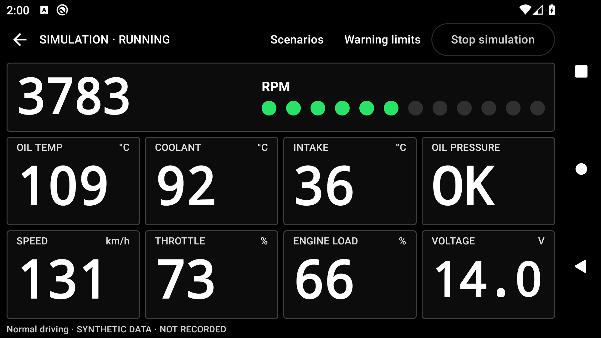

# TrackDash

Open-source, local-first Android performance monitoring and GPS lap timing for manual cars.
No account or cloud service is required. Android 10+ (API 29),
compile/target API 37. Version 0.3 integrates simulation, GPS timing, track editing,
foreground recording, standard OBD, analysis, and local export.



**Development software, not an engine-protection system.** TrackDash supplements,
never replaces, the vehicle's instruments and factory warnings. Configure and
operate it only while stationary. Hardware compatibility and outdoor timing must
be checked on your own setup; no physical vehicle is currently certified.

## Build and install

Use JDK 17 and Android SDK API 37 (`platforms/android-37.0`), build tools 36.0.0.
Set `ANDROID_HOME` or an ignored `local.properties` with `sdk.dir`.

```powershell
.\gradlew.bat :core:test :app:testDebugUnitTest :app:verifyOpenSourceInventory :app:lintDebug :app:assembleDebug
adb install -r app/build/outputs/apk/debug/app-debug.apk
```

On macOS/Linux use `./gradlew`. Dependencies need network on the first build.
GPS, timing, vehicle data, saved gates, recording, review and export work offline.
Online map tiles/search are optional and require your configured provider.

## Try it without a car

Choose a mode on Home, then **Set up recording**. Leave **Simulation** enabled and
press **Start recording**. GPS simulation uses the saved demo circuit; combined
mode also records synthetic vehicle readings. Change lap pace, trigger GPS loss,
a location jump, overheating, low oil pressure or disconnect while recording.
The first start/finish crossing starts the timer; the next completes a lap.
Use **Stop and save**, then **Sessions** to review laps, charts, warnings and CSV.
All synthetic data is identified as simulation in the UI and export.

**Try vehicle simulation** is a separate lightweight demo: it stops in the
background and does not record. Session recording continues with a foreground
service through navigation, rotation and normal backgrounding.

## Driving display and warnings

The landscape rally display uses large white numbers on black, compact controls,
and 12 green/yellow/red RPM lights. Configure **Shift RPM / redline** for a real
vehicle profile; no vehicle limit is assumed. Reaching that limit flashes a
full-screen **SHIFT** prompt three times, followed by a steady prompt until RPM
falls more than 200 RPM below the limit.

New engine-safety warnings flash individually, three pulses per warning. Low oil
pressure has first priority among simultaneous warnings; additional warnings join
the queue. Cleared warnings leave the queue, and active warning banners/gauge
highlights remain until the conditions clear. GPS loss and stale/disconnected data
show status warnings without triggering the engine-safety flash.

Home, Tracks, and Sessions use an icon rail in landscape and an icon-only bottom
bar in portrait. Connection Status is available through **Settings → Maps & advanced**.
Back leaves an active recording running; **Stop and save** explicitly ends it.

## Discover your car's standard OBD-II sensors

Park safely, turn Simulation off in recording setup, choose your paired adapter
and vehicle profile, and run sensor discovery. Review the responding ECUs,
available sensors, missing sensors, and readiness panel before starting. Discovery
reports advertised support, not proof of sensor accuracy or useful update rates.
A saved vehicle name never implies sensor support. No manufacturer limits are assumed.

Only standard read-only OBD-II is in scope: no fault-code repair tools, fault clearing,
coding, actuation, or proprietary sensor guesses. Generic OBD-II does not provide
a discrete low-oil-pressure switch; an unavailable sensor is not a healthy one.
See the [compatibility matrix and report guide](docs/vehicle-compatibility.md).

### Veepeak OBDCheck BLE on Android

1. Plug the adapter into the stationary vehicle and turn on ignition.
2. Pair **VEEPEAK** in Android Bluetooth settings; the vendor specifies PIN **1234**.
3. In TrackDash, choose Vehicle dashboard or Combined telemetry, open recording
   setup, turn Simulation off, and load paired Classic adapters.
4. Select VEEPEAK and a vehicle profile. For combined mode, also select a track.
5. Grant permissions, then choose **Discover available sensors** while stationary.
   Inspect each ECU's advertised support and actual decoded readings. A saved
   model name or cached check is not evidence that a sensor is available now.
6. Review **Monitoring readiness**, configure your own limits in Settings, then
   start recording. Checks expire after two minutes; recording checks again.
   A known different VIN cannot silently replace a profile or reuse its limits.
   When VIN is unavailable, confirm the selected profile yourself.

[Veepeak's Android instructions](https://veepeak.com/pages/obdcheck-ble) use Classic
Bluetooth even though the product name includes BLE. Only read-only standard
OBD queries are sent. Sensor availability comes from the responding ECU, not the
vehicle name. Unsupported oil temperature remains unavailable; oil pressure is
never fabricated. Physical adapter and vehicle validation is still required.

An **experimental OBDLink CX BLE** option uses its documented UART service and
acknowledged writes. It is not a generic driver for every BLE adapter and has not
been hardware-tested. See [protocol evidence](docs/obd-protocol.md).

## Create a track

Open **Tracks → New track**. Navigate with the map or enter latitude/longitude.
Choose **Draw start / finish**, then tap two endpoints across the circuit.
Select an accepted direction; add ordered sector gates, redraw/reorder them and
save. Gates must be 1–500 m long. Export/import versioned JSON from the library;
imports create a copy rather than overwrite an existing track.

The default map is an offline background with gates and recorded paths. In
**Vehicles & settings**, configure an authorized HTTPS MapLibre style and optional
Nominatim-compatible search endpoint, or import a licensed MapLibre offline-region
database. Offline packages are not arbitrary MBTiles files. Timing never needs
map tiles. Imported packages may lack resources; check coverage before use.

## Settings and analysis

Create vehicle profiles, choose gauges and their order, size and bar presentation,
units, keep-awake/fullscreen behavior, and warning settings. Temperature/RPM
thresholds are user supplied; there are no assumed manufacturer safety limits. Recording
snapshots settings at start. Session notes, complete samples, warnings and track
snapshots stay locally in Room. Android backup is disabled.

Session analysis includes exact recorded peaks, sampled charts and GPS paths,
valid best/average lap, sectors, and two-lap comparisons by elapsed time. CSV is
written through Android's document picker in bounded pages with timestamps,
canonical units, source and availability status. Stop a session before export.

Use the trash action in session history or session details to permanently delete
a finished or interrupted session and its samples, laps, events, and notes. A
confirmation is required, and active recordings cannot be deleted.

## Validation and remaining work

JVM tests, Android 10 emulator tests, lint and debug builds are documented in
[testing](docs/testing.md). This is a development build, not a hardware-qualified
release. Proprietary enhanced commands, repair/fault-code operations and vehicle
writes are out of scope. Modern-device foreground-service,
Bluetooth, GNSS accuracy, thermal/battery and long-run tests remain release gates.
See [roadmap](docs/roadmap.md), [limitations](docs/known-limitations.md),
[architecture](docs/architecture.md), and [integration review](docs/reviews/integrated-telemetry.md).

## Replay and optional sharing

Use local, read-only [session replay](docs/session-replay.md) to investigate a
saved recording without connecting to a vehicle. Original sample timestamps and
availability are retained; replay never writes a new session or shares packets.

Optional [sensor-only HTTPS sharing](docs/telemetry-sharing.md) is off by default
and sends a fixed allowlisted packet to a receiver you control. It excludes GPS
coordinates, VIN, wall-clock time, session/vehicle identifiers, track names and
notes. The receiver still sees network IP. A slow or unavailable receiver never
blocks local recording. No project-operated cloud backend is provided.

CSV and track exports are not anonymous: they can contain exact locations and
personal notes. Inspect and redact files before posting. See [Privacy](PRIVACY.md).

## Contributing and license

Start with [Contributing](CONTRIBUTING.md), [Security](SECURITY.md), and the
[release checklist](docs/release-checklist.md). `core` is platform-independent
telemetry/protocol logic; `app` supplies Android hardware, persistence, recording
and UI. Small tested changes and sanitized protocol fixtures are welcome.

Copyright 2026 Omer Chandna and TrackDash contributors. Source and documentation
are licensed under [Apache-2.0](LICENSE), unless a file states otherwise.
Third-party components retain their own licenses; see
[third-party notices](THIRD_PARTY_NOTICES.md). Provider data is not relicensed by
this project. Debug APKs are not signed production releases.
