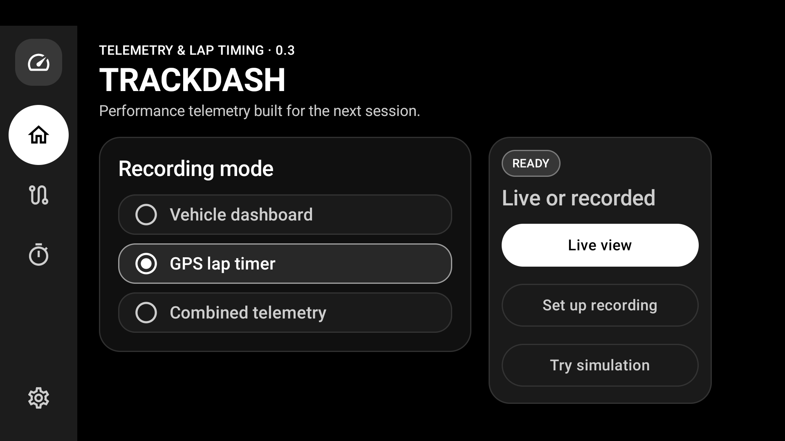
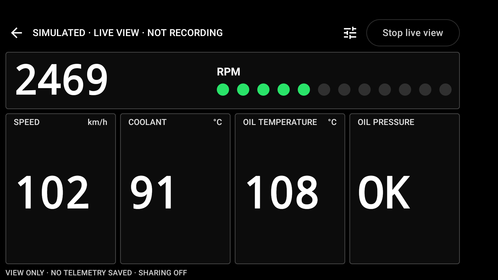

# Non-recording live performance view

Branch: `codex/live-performance-view`, based on merged main `07b71a7` (PRs #2/#3).
Status: IN_REVIEW; no merge, push or production release is performed by this change.

## Behavior

- Home separates Live view from the selected recording mode. Setup defaults to
  real vehicle sources, supports simulation, and reuses the profile/adapter/sensor
  discovery and readiness controls. No track is needed.
- The shared service enforces vehicle-only live view independently of requested
  mode extras. It creates no session ID, channel, writer, telemetry/event/snapshot
  payload, GPS collector, lap timer or sharing worker. Existing saved data is not
  deleted, and recording-enabled sharing cannot opt a live view into transmission.
- Current readings and warnings stay in memory. Units, chosen gauges, RPM lights,
  configured SHIFT hysteresis, warning sequencing/audio, stale states, source
  recovery and display policies use the same pipeline as recording.
- Live view and recording have separate labels and stop actions, including the
  notification. Stop and visible/system Back end live view without a save step.
  Rotation preserves it; normal backgrounding keeps the foreground service alive.
  A pending start is stopped when leaving, and a second mode cannot replace an
  active service. Recording Back/Stop-and-save behavior is preserved.
- Setup checks do not update a live-view profile's VIN/capability cache. Runtime
  VIN mismatch protection remains. Explicit Settings/report saves and ordinary app
  database initialization are separate from trip recording.

No Room migration, telemetry model/CSV change, proprietary sensor command,
external receiver, production key or background restart was added. Standard OBD
does not supply a discrete oil-pressure switch. Thresholds are user configured.

## Validation

The complete command
`:core:test :app:testDebugUnitTest :app:lintDebug :app:assembleDebug :app:verifyOpenSourceInventory :app:connectedDebugAndroidTest`
passed on the final candidate: 102 JVM tests (77 core + 25 app), all 31 API 29
Android tests, zero lint issues, debug assembly and the 97-coordinate attribution
check. APK signature verification passed with the development signing key. No
production key or production-release qualification is implied.

The live-view UI test was rerun directly with synthetic data to retain screenshots.
Home's three actions fit on the representative landscape phone; the immersive
dashboard shows large gauges, NOT RECORDING, no lap/save controls and sharing off.
See `docs/testing.md` for regression details. Remote CI was not run for this
unpublished branch. Real Bluetooth/vehicle and current-Android permission/service
qualification remain required; simulation/API 29 tests are not a hardware guarantee.

