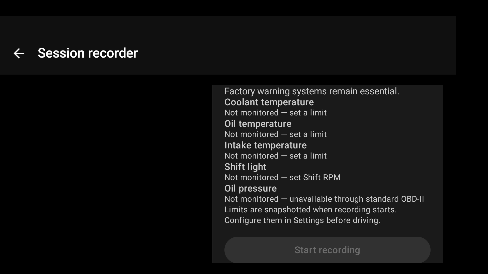
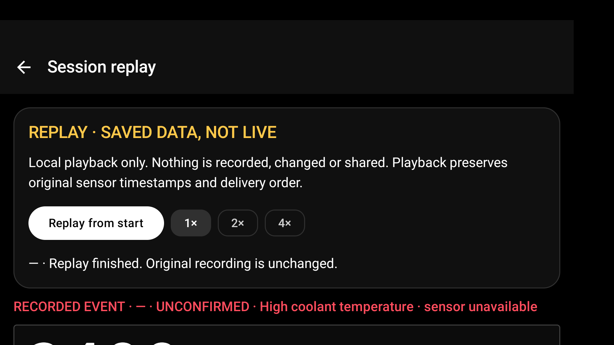

# Monitoring reliability and standard OBD-II readiness

Base: merged main `18c4710` (rally refresh PR #1). Functional branch:
`codex/monitoring-reliability`. No Room migration or telemetry/CSV column change.

## Delivered behavior

- Source-independent OBD/GPS recovery. Only upstream acquisition retries;
  persistence failures stop capture and cannot claim a successful save.
- Clock-driven stale-value projection, invalid/stale GPS speed suppression,
  unresolved established engine warnings, and separate confirmed/unconfirmed
  string events. Missing data is never interpreted as recovery.
- Blocking validation for invalid warning limits; profile loading gates Save.
- One shared standard OBD-II inspector for setup and recording, per-ECU support
  pages and actual decoded reads, conservative unknown states, useful engine ECU
  selection, two-minute setup checks, and a guarded VIN/profile association.
- An explicit monitoring-readiness panel, including unavailable oil-pressure
  protection. Optional sanitized compatibility JSON exports, never auto-uploaded.
- Local read-only replay of existing recordings, bounded paging/gaps and 1×/2×/4×
  playback. Back restores session details without starting recording or sharing.
- Opt-in sensor-only HTTPS packets with Keystore-encrypted authorization, bounded
  non-blocking queue, cadence, timeouts, error/drop counts and no redirects.
  No GPS coordinates, VIN, notes, gear, identifiers or history are sent.

No arbitrary commands, repair/fault-code operations, manufacturer-specific sensor
providers, in-app server or cloud account were introduced.

## Verification and review

The combined candidate passed 77 core + 23 app JVM tests, all 26 API 29 Android
tests (including the companion attribution viewer), attribution inventory for
97 runtime coordinates, debug APK assembly and lint. The final lint report has
zero errors and warnings. Three selected visual checks were also rerun directly
on the emulator to retain screenshots for inspection.

Tests exposed and fixed an outdated disconnect expectation and a real restoration
bug: the initial empty Room loading value used to clear the saved detail selection
when returning from replay. Regression coverage now waits for a real list before
removing an absent selection. Storage failure is injected explicitly and reports
ERROR, not Saved. Existing sequential warning, SHIFT and deletion tests remain.

The companion open-source packaging branch adds Apache-2.0, bundled third-party
notices, privacy/security/contribution guidance and release/compatibility gates.
These branches are reviewed separately; do not advertise a release solely because
one PR is merged. Remote CI and physical qualification are separate evidence.

## Inspected synthetic previews

These show the no-hardware setup state and a synthetic saved recording, not
verified vehicle compatibility. Setup and replay are intentionally scrollable.

## Remaining physical/deployment gates

Real adapter/ECU compatibility and measured per-sensor rates; current Android
permissions/services; outdoor GNSS; long-run battery/thermal/storage behavior;
actual HTTPS receiver/TLS/mobile-network behavior; owner-controlled production
signing and release distribution. Do not induce dangerous engine faults to test.
